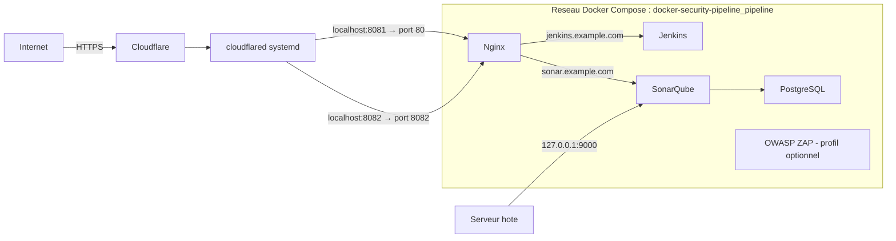

# Architecture

## Périmètre actuellement déployé

La configuration `docker-compose.yml` déploie les services suivants :

| Service | Rôle | Exposition |
| --- | --- | --- |
| Nginx (`nginx-pipeline`) | Reverse proxy | `127.0.0.1:8081 → 80` et `127.0.0.1:8082 → 8082` |
| Jenkins | Exécution CI/CD | Réseau Docker uniquement; routé par Nginx |
| SonarQube | Analyse de code | Réseau Docker et `127.0.0.1:9000` sur l'hôte |
| PostgreSQL (`sonarqube-db`) | Base SonarQube | Réseau Docker uniquement |
| OWASP ZAP (`zap`) | Outil de sécurité optionnel | Profil `security-tools`; aucun port publié |

Tous les services utilisent le réseau bridge `pipeline`. Jenkins, SonarQube et
PostgreSQL disposent de volumes nommés pour conserver leurs données.

## Flux réseau

Nginx choisit le service amont selon le nom d'hôte HTTP. Les noms actuels sont
`jenkins.example.com` et `sonar.example.com`; ils sont définis dans
[`nginx/conf.d/default.conf`](../nginx/conf.d/default.conf). Le DNS doit pointer
vers le tunnel Cloudflare. Cloudflared tourne sur l'hôte, pas dans Docker : il
utilise les bindings loopback `http://localhost:8081` et `http://localhost:8082`.
Il n'a pas besoin de rejoindre le réseau Docker. Configure `httpHostHeader` avec
le hostname correspondant pour chaque ingress du tunnel.

Jenkins n'a pas de port publié sur l'hôte. Nginx le joint par son nom de service
Compose (`jenkins`). Les ports hôte de Nginx sont publiés uniquement sur
`127.0.0.1`; PostgreSQL n'est pas publié. Cloudflare termine le TLS public; les
origines restent en HTTP local. Cloudflare Access protège les deux applications;
le webhook Jenkins doit disposer d'une exception de chemin spécifique et d'un
secret GitHub pour ne pas bloquer les événements.

ZAP est sous profil optionnel. Sa commande actuelle met à jour les modules
complémentaires puis se termine; elle ne lance pas de scan.

## Cloudflare Tunnel et Access

Le tunnel Cloudflare existe déjà et Cloudflared est géré par systemd.
Conserver son UUID et ses credentials; ne pas créer un autre tunnel. Ajouter les
deux règles d'ingress vers `localhost:8081` et `localhost:8082`, avec
`originRequest.httpHostHeader` réglé respectivement à `jenkins.example.com` et
`sonar.example.com`. Une liaison Docker commune avec Cloudflared n'est pas
nécessaire puisque le client tunnel tourne sur l'hôte.

## Architecture cible

Les diagrammes Mermaid ci-dessous décrivent une architecture DevSecOps plus
complète que la stack déployée. Ils incluent des outils non présents dans le
Compose actuel, par exemple Harbor, Vault, DefectDojo, Trivy, Checkov,
Prometheus, Grafana et Falco. Ils servent de cible et ne doivent pas être
interprétés comme des services déjà installés.

- [Vue d'ensemble des composants et de leurs relations](assets/deepseek_mermaid_20261030_4db7ca.mermaid)
- [Séquence envisagée pour un pipeline CI/CD](assets/deepseek_mermaid_20261030_009da0.mermaid)
- [Roadmap de déploiement par phases](assets/deepseek_mermaid_20261030_bac46e.mermaid)

## Captures Jenkins

Captures disponibles dans `assets/`, classées par heure de capture :

