# Analyser la qualité et la sécurité du code avec Jenkins et SonarQube sur Docker

Chaque commit peut introduire un bug, une faille ou du code difficile à
maintenir. L'**analyse statique (SAST)** détecte ces problèmes en lisant le code,
avant même qu'il soit exécuté. Cet article montre comment monter, avec Docker
Compose, un petit pipeline où **Jenkins** lance automatiquement une analyse
**SonarQube** et bloque le build si le code ne respecte pas les règles de
qualité.

## Ce que l'on construit

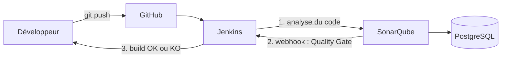

1. Jenkins récupère le code depuis GitHub.
2. SonarScanner envoie le code à SonarQube, qui l'analyse.
3. SonarQube calcule le **Quality Gate** et renvoie le résultat à Jenkins par
   webhook.
4. Si le Quality Gate échoue, le build échoue.

## Prérequis

- Une machine Linux avec Docker Engine et Docker Compose v2.
- Environ 4 Go de RAM libres (SonarQube embarque Elasticsearch).
- Un dépôt GitHub à analyser.

SonarQube exige un réglage du noyau pour Elasticsearch :

```bash
sudo tee /etc/sysctl.d/99-sonarqube.conf >/dev/null <<'CONF'
vm.max_map_count=524288
fs.file-max=131072
CONF
sudo sysctl --system
```

## Étape 1 : la stack Docker Compose

Trois services suffisent : Jenkins, SonarQube et sa base PostgreSQL. Ils
partagent un réseau Docker, ce qui leur permet de se joindre par leur nom de
service (`jenkins`, `sonarqube`).

```yaml
services:
  jenkins:
    image: jenkins/jenkins:lts-jdk21
    restart: unless-stopped
    ports:
      - "127.0.0.1:8080:8080"
    volumes:
      - jenkins_home:/var/jenkins_home
    networks: [pipeline]

  sonarqube:
    image: sonarqube:26.10.0.133078-community
    restart: unless-stopped
    depends_on:
      sonarqube-db:
        condition: service_healthy
    environment:
      SONAR_JDBC_URL: jdbc:postgresql://sonarqube-db:5432/sonarqube
      SONAR_JDBC_USERNAME: sonar
      SONAR_JDBC_PASSWORD: ${SONAR_DB_PASSWORD}
    ports:
      - "127.0.0.1:9000:9000"
    volumes:
      - sonarqube_data:/opt/sonarqube/data
      - sonarqube_extensions:/opt/sonarqube/extensions
    networks: [pipeline]

  sonarqube-db:
    image: postgres:17-alpine
    restart: unless-stopped
    environment:
      POSTGRES_DB: sonarqube
      POSTGRES_USER: sonar
      POSTGRES_PASSWORD: ${SONAR_DB_PASSWORD}
    volumes:
      - sonarqube_db:/var/lib/postgresql/data
    healthcheck:
      test: ["CMD-SHELL", "pg_isready -U sonar -d sonarqube"]
      interval: 10s
      retries: 10
    networks: [pipeline]

volumes:
  jenkins_home:
  sonarqube_data:
  sonarqube_extensions:
  sonarqube_db:

networks:
  pipeline:
```

Quelques choix à retenir :

- **Ports liés à `127.0.0.1`** : les interfaces d'administration ne sont pas
  exposées sur Internet. Pour un accès distant, passe par un reverse proxy ou un
  tunnel (ce dépôt utilise Nginx et Cloudflare Tunnel).
- **Version de SonarQube fixée** : le tag `community` change chaque mois et
  migre la base sans prévenir. Un tag précis rend les mises à jour volontaires.
- **Mot de passe dans `.env`**, jamais dans le fichier Compose :

```dotenv
SONAR_DB_PASSWORD=un_mot_de_passe_long_et_unique
```

Ajoute `.env` à `.gitignore`, puis démarre la stack :

```bash
docker compose up -d
docker compose logs -f sonarqube   # attendre "SonarQube is operational"
```

## Étape 2 : préparer SonarQube

### Premier accès

Ouvre `http://127.0.0.1:9000`, connecte-toi avec `admin` / `admin` et change
le mot de passe.

### Relier SonarQube à GitHub

Pour importer les dépôts directement, SonarQube utilise une **GitHub App**.

1. Dans SonarQube, ouvre **Administration → Configuration → DevOps Platform
   Integrations → GitHub**.

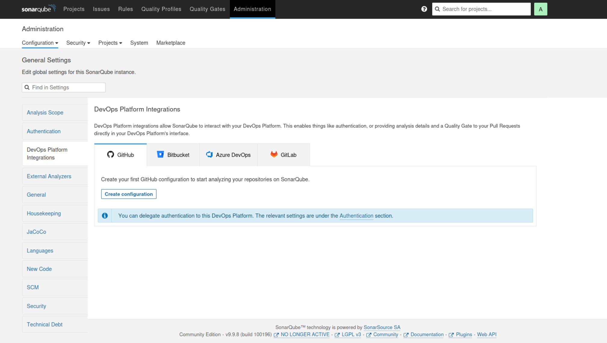

2. Sur GitHub, crée l'app : **Settings → Developer settings → GitHub Apps →
   New GitHub App**.

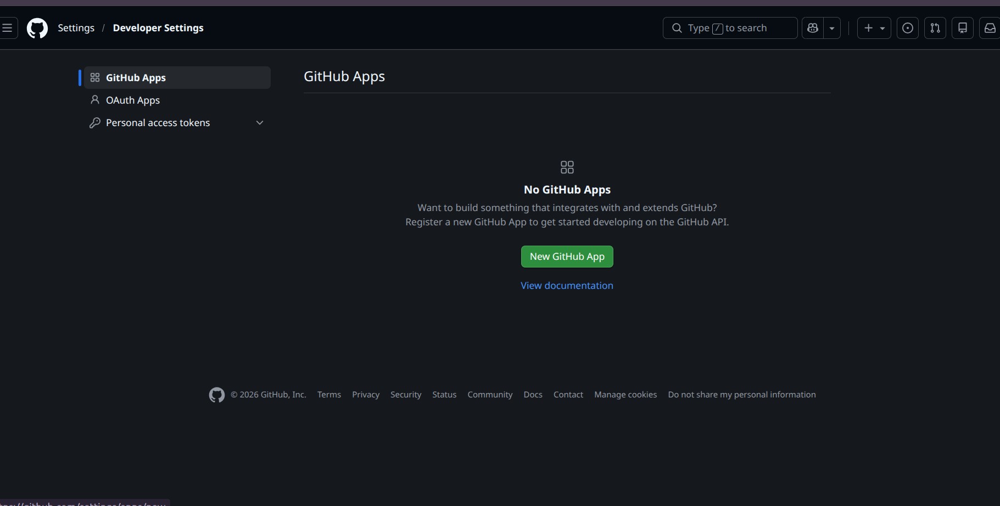

3. Donne-lui un nom et une Homepage URL, puis génère son **Client secret** et sa
   **Private key**.

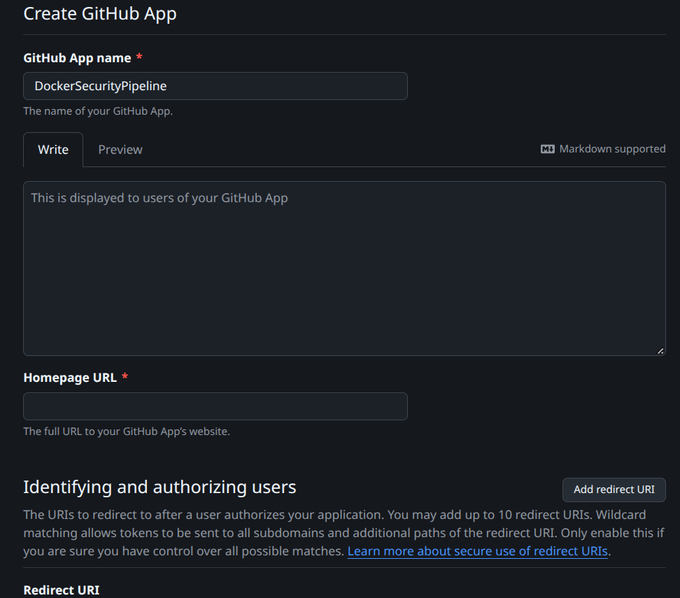

4. Reporte l'App ID, le Client ID, le Client secret et la clé privée dans
   SonarQube, puis vérifie la configuration.

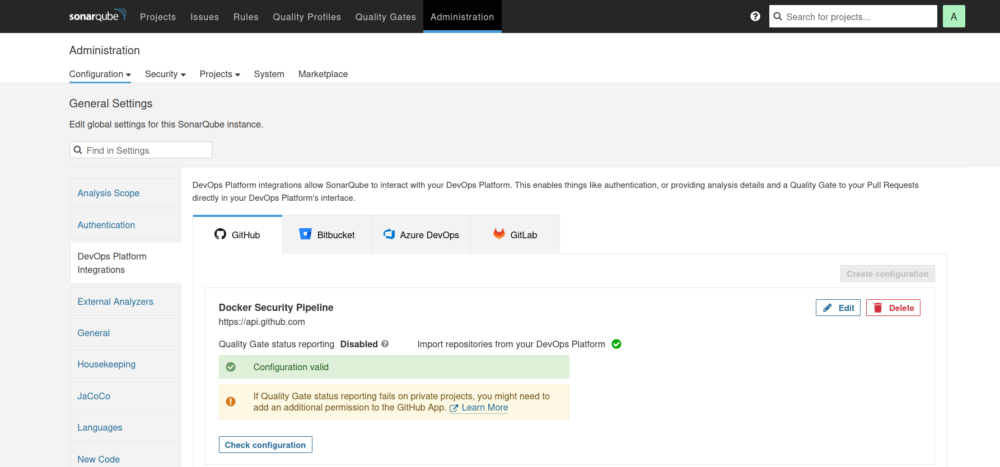

5. Installe l'app sur les dépôts à analyser (**Only select repositories**).

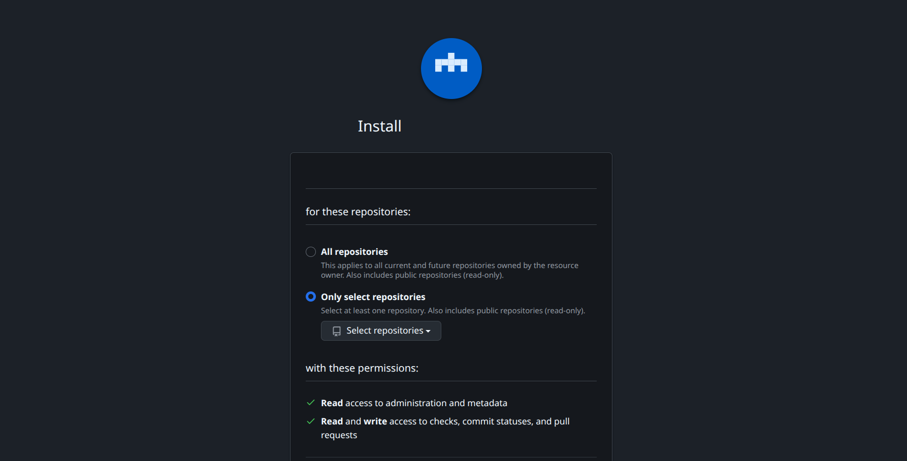

Le détail des champs et des permissions est dans le
[guide SonarQube](sonarqube/readme.md).

### Créer le projet

Dans **Projects → Create Project**, importe le dépôt depuis GitHub (ou crée le
projet manuellement). Note sa **clé de projet**.

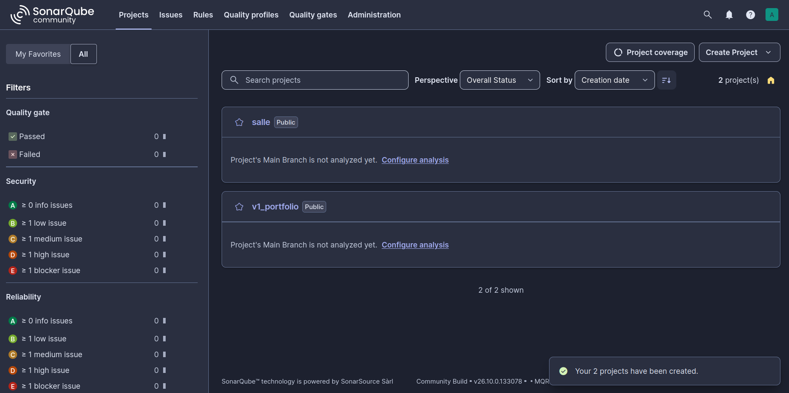

### Token et webhook

1. Génère un token : **My Account → Security → Generate Tokens**, type
   *Global Analysis Token*. Copie-le, il ne sera plus affiché.

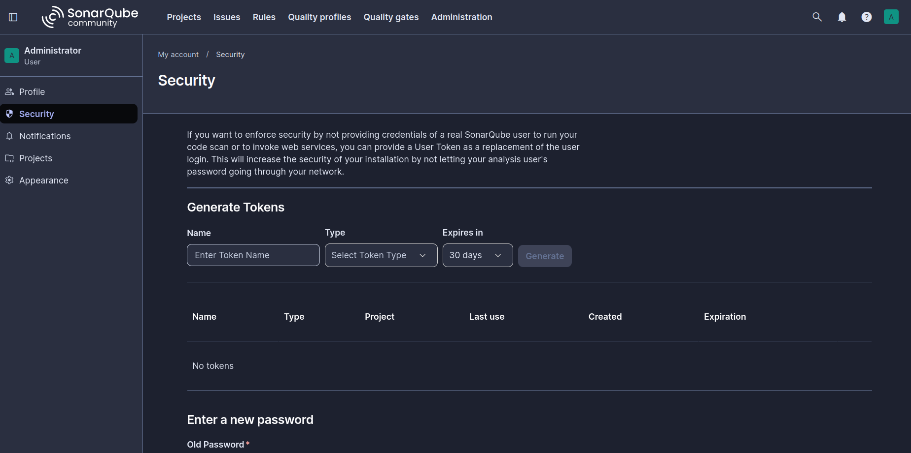

2. Crée le webhook vers Jenkins : **Administration → Configuration → Webhooks →
   Create**, avec l'URL `http://jenkins:8080/sonarqube-webhook/`.

Le webhook utilise le nom de service Docker `jenkins` : le trafic reste dans le
réseau interne.

## Étape 3 : préparer Jenkins

1. Ouvre `http://127.0.0.1:8080` et termine l'assistant d'installation (le mot
   de passe initial s'obtient avec
   `docker compose exec jenkins cat /var/jenkins_home/secrets/initialAdminPassword`).

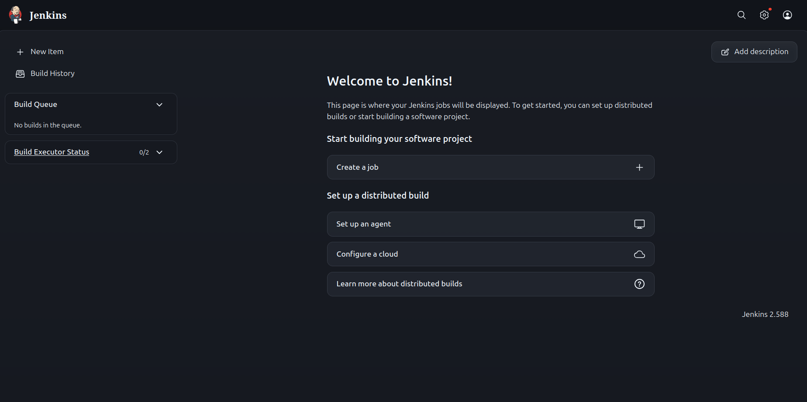

2. Installe le plugin **SonarQube Scanner** (**Manage Jenkins → Plugins →
   Available plugins**).

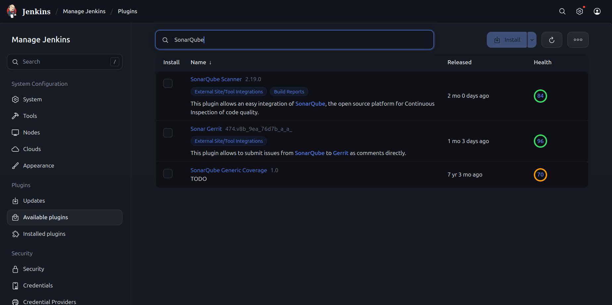

3. Dans **Manage Jenkins → Credentials**, ajoute le token SonarQube comme
   credential **Secret text**, avec l'ID `sonarqube-token`.

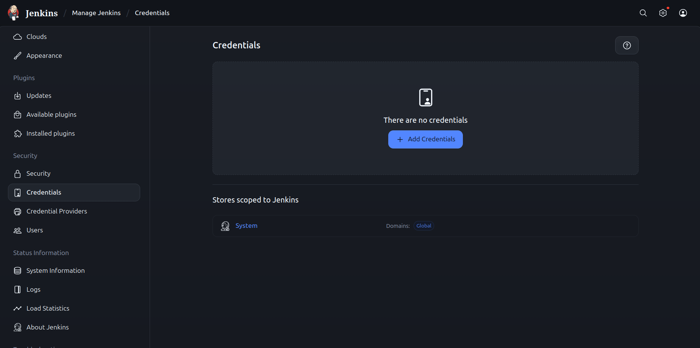

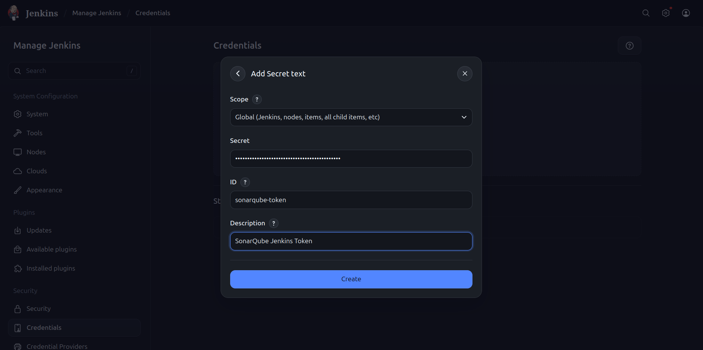

4. Dans **Manage Jenkins → System → SonarQube servers**, ajoute un serveur nommé
   `SonarQube`, d'URL `http://sonarqube:9000`, avec le credential
   `sonarqube-token`.

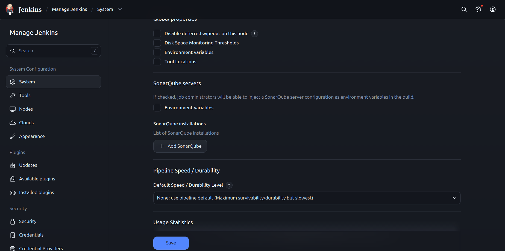

5. Dans **Manage Jenkins → Tools → SonarQube Scanner installations**, ajoute un
   scanner nommé `SonarScanner` en installation automatique.

## Étape 4 : le Jenkinsfile

Crée dans Jenkins un job **Pipeline** (**New Item → Pipeline**) :

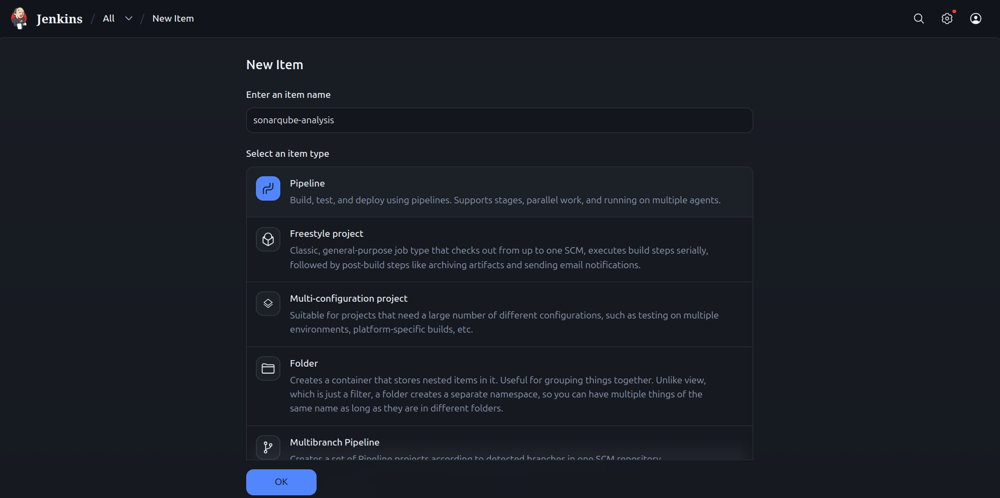

Dans sa configuration, coche **GitHub project**, puis dans **Pipeline** choisis
*Pipeline script from SCM*, le dépôt, la branche `*/main` et le chemin
`Jenkinsfile`.

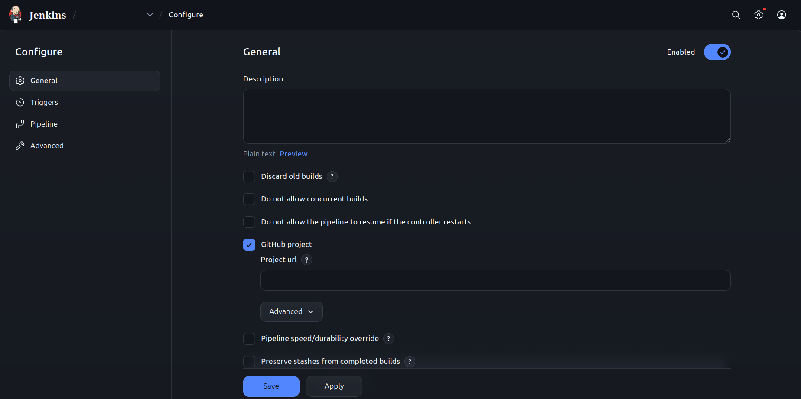

SonarQube rappelle ces réglages dans l'onboarding du projet
(**Analysis Method → Jenkins**) :

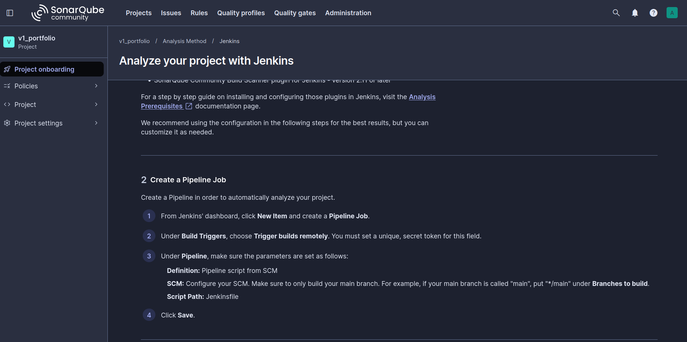

Place ensuite ce `Jenkinsfile` à la racine du dépôt analysé :

```groovy
pipeline {
    agent any

    stages {
        stage('Checkout') {
            steps {
                checkout scm
            }
        }

        stage('SonarQube Analysis') {
            steps {
                script {
                    def scannerHome = tool 'SonarScanner'
                    withSonarQubeEnv('SonarQube') {
                        sh "${scannerHome}/bin/sonar-scanner -Dsonar.projectKey=<cle-du-projet> -Dsonar.sources=."
                    }
                }
            }
        }

        stage('Quality Gate') {
            steps {
                timeout(time: 10, unit: 'MINUTES') {
                    waitForQualityGate abortPipeline: true
                }
            }
        }
    }
}
```

`withSonarQubeEnv` fournit au scanner l'URL et le token sans les écrire dans le
code. `waitForQualityGate` attend le webhook de SonarQube et arrête le pipeline
si le Quality Gate échoue.

## Étape 5 : lire les résultats

Lance le job avec **Build Now**. Jenkins affiche chaque étape ; le stage
*Quality Gate* attend la réponse du webhook :

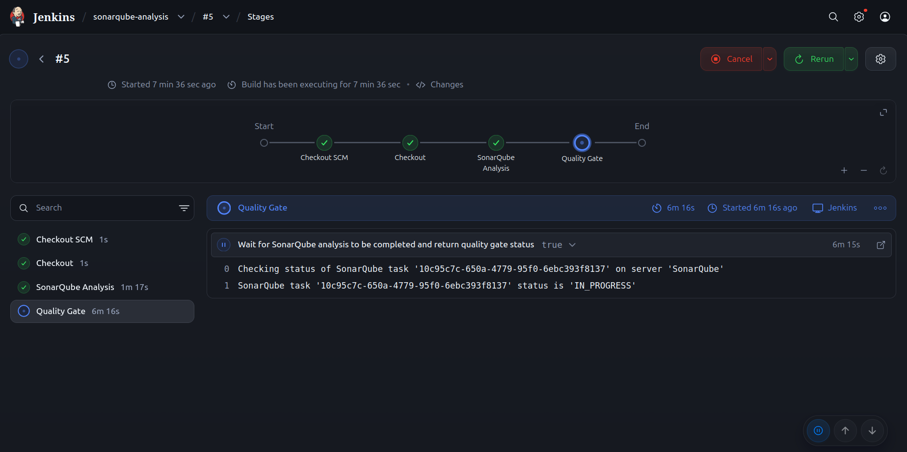

Une fois l'analyse terminée, la page du projet dans SonarQube présente :

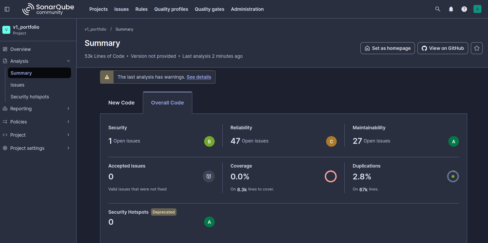

| Indicateur | Ce qu'il mesure |
| --- | --- |
| Security | Vulnérabilités exploitables dans le code |
| Security Hotspots | Code sensible à revoir manuellement |
| Reliability | Bugs probables |
| Maintainability | Code smells, dette technique |
| Coverage | Part du code couverte par les tests |
| Duplications | Code copié-collé |

Le Quality Gate par défaut (*Sonar way*) se concentre sur le **nouveau code** :
il échoue si le code ajouté introduit des problèmes, même si l'ancien code n'est
pas parfait. Cela permet d'améliorer un projet existant progressivement.

## Bonnes pratiques de sécurité

- Ne publie aucun port d'administration sur `0.0.0.0` ; garde `127.0.0.1` ou
  un réseau interne.
- Stocke les tokens dans les credentials Jenkins, jamais dans le Jenkinsfile.
- Donne des tokens à durée limitée et aux droits minimaux (lecture seule pour
  GitHub).
- Fixe les versions des images et sauvegarde PostgreSQL (`pg_dump`) avant
  chaque mise à jour de SonarQube.
- Vérifie les captures d'écran avant de les publier : tokens, noms d'utilisateur
  et URLs internes y apparaissent souvent.

## Pour aller plus loin

- Ajouter un rapport de couverture (JaCoCo, `coverage.xml`, `lcov.info`) pour
  alimenter l'indicateur *Coverage*.
- Compléter le SAST par d'autres contrôles : secrets (Gitleaks), dépendances
  (OWASP Dependency-Check), images (Trivy) et tests dynamiques (OWASP ZAP).

Les guides détaillés de ce dépôt, avec captures d'écran, sont
[SonarQube](sonarqube/readme.md) et [Jenkins](Jenkins/Readme.md).
