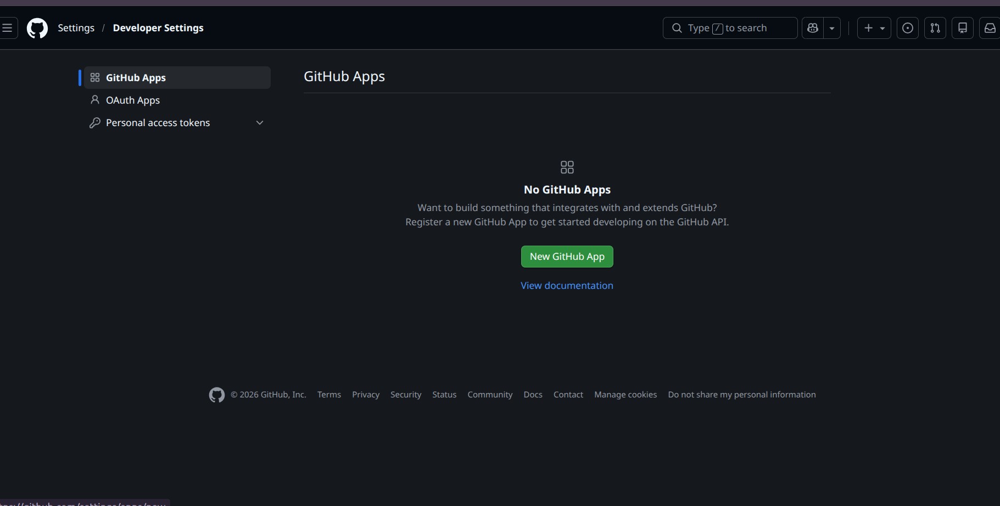
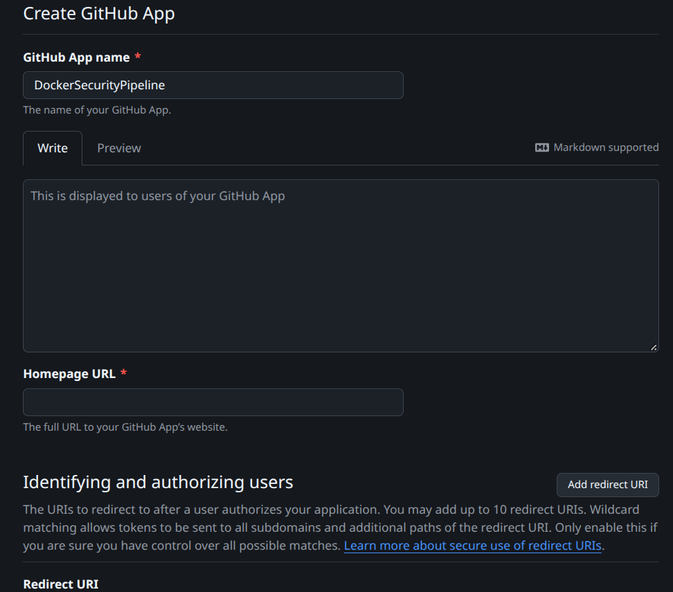
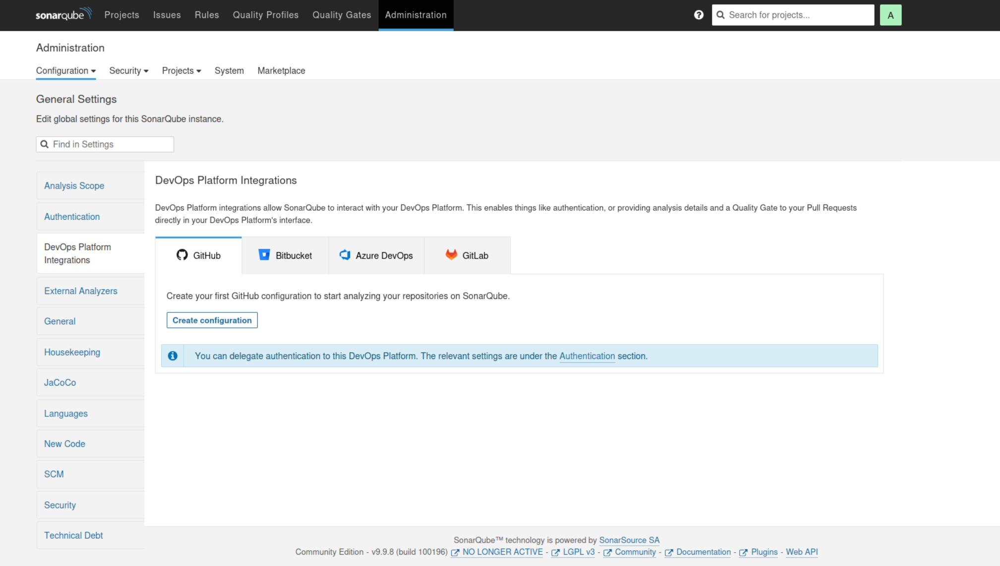
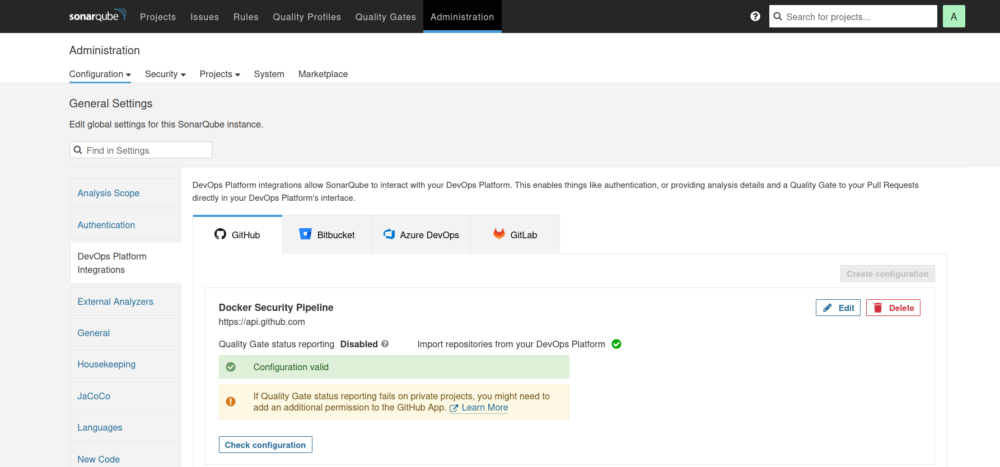
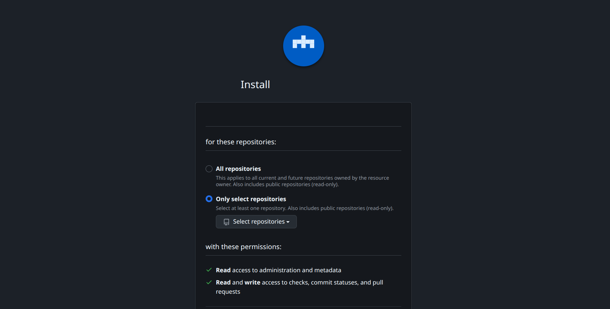
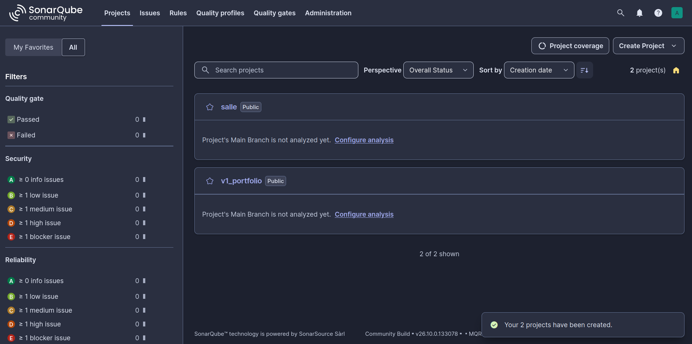

# SonarQube : configuration et intégration GitHub

## Qu'est-ce que SonarQube ?

SonarQube est un outil d'analyse statique du code (SAST). Il lit le code source
sans l'exécuter et signale :

- les **vulnérabilités** et **security hotspots** (sécurité) ;
- les **bugs** (fiabilité) ;
- les **code smells** et la duplication (maintenabilité) ;
- la **couverture de tests**, si un rapport est fourni.

Un **Quality Gate** regroupe des seuils (par exemple « aucune nouvelle
vulnérabilité »). Jenkins s'en sert pour faire échouer un build quand le code ne
respecte pas ces seuils.

Dans cette stack, SonarQube tourne en **Community Build** (version fixée dans
[`sonarqube/Dockerfile`](../../sonarqube/Dockerfile)) avec une base PostgreSQL.

## Sommaire

1. [Premier accès](#1-premier-accès)
2. [Créer une GitHub App](#2-créer-une-github-app)
3. [Déclarer la GitHub App dans SonarQube](#3-déclarer-la-github-app-dans-sonarqube)
4. [Installer l'app sur les dépôts](#4-installer-lapp-sur-les-dépôts)
5. [Importer les projets](#5-importer-les-projets)
6. [Étape suivante : Jenkins](#6-étape-suivante--jenkins)

## 1. Premier accès

1. Ouvre `http://127.0.0.1:9000` sur le serveur, ou `https://sonar.example.com`
   via le tunnel.
2. Connecte-toi avec `admin` / `admin`, puis change immédiatement le mot de passe.
3. Dans **Administration → Configuration → General → Server base URL**, indique
   l'URL publique (`https://sonar.example.com`).

## 2. Créer une GitHub App

La GitHub App permet à SonarQube de lister et d'importer tes dépôts.

1. Sur GitHub : avatar → **Settings → Developer settings → GitHub Apps →
   New GitHub App**. Pour une organisation : **Your organizations → Settings →
   Developer settings**.

2. Remplis le formulaire :

| Champ | Valeur |
| --- | --- |
| GitHub App name | un nom unique, par exemple `DockerSecurityPipeline` |
| Homepage URL | l'URL de ton dépôt ou de SonarQube |
| Callback URL | `https://sonar.example.com/projet/create` |
| Webhook | désactivé (décoche **Active**) |

3. Permissions minimales :

| Permission | Accès |
| --- | --- |
| Repository → Checks | Read and write |
| Repository → Metadata | Read-only |
| Repository → Pull requests | Read and write |
| Repository → Contents | Read-only (dépôts privés) |

4. Crée l'app, puis dans sa page :
   - note l'**App ID** et le **Client ID** ;
   - génère un **Client secret** ;
   - génère une **Private key** (fichier `.pem` téléchargé).

> Le client secret et la clé privée sont des secrets : garde-les hors du dépôt
> et supprime le fichier `.pem` une fois copié dans SonarQube.

## 3. Déclarer la GitHub App dans SonarQube

1. Ouvre **Administration → Configuration → General Settings → DevOps Platform
   Integrations → GitHub → Create configuration**.

2. Renseigne :

| Champ | Valeur |
| --- | --- |
| Configuration name | un nom libre |
| GitHub API URL | `https://api.github.com/` |
| GitHub App ID | App ID de l'étape 2 |
| Client ID / Client Secret | valeurs de l'étape 2 |
| Private Key | contenu complet du fichier `.pem` |

3. Enregistre puis clique sur **Check configuration** : le message
   **Configuration valid** doit apparaître.

## 4. Installer l'app sur les dépôts

1. Dans la page de la GitHub App, clique sur **Install App**.
2. Choisis **Only select repositories** et sélectionne les dépôts à analyser.

## 5. Importer les projets

1. Dans SonarQube : **Projects → Create Project → Import from GitHub**.
2. Sélectionne les dépôts, puis valide.

Chaque projet importé reçoit une **clé de projet**, utilisée par le scanner.

## 6. Étape suivante : Jenkins

Pour lancer les analyses automatiquement, suis le guide
[Jenkins : intégration avec SonarQube](../Jenkins/Readme.md).

## Références

- [Registering a GitHub App](https://docs.github.com/en/apps/creating-github-apps/registering-a-github-app/registering-a-github-app)
- [SonarQube : intégration GitHub](https://docs.sonarsource.com/sonarqube-community-build/devops-platform-integration/github-integration/introduction/)
