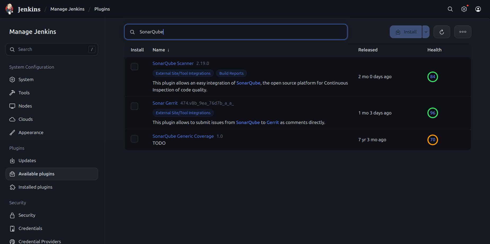
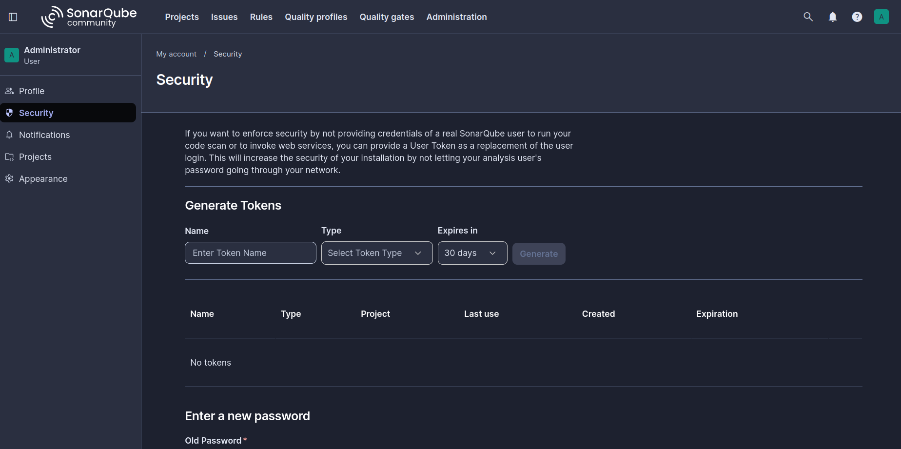
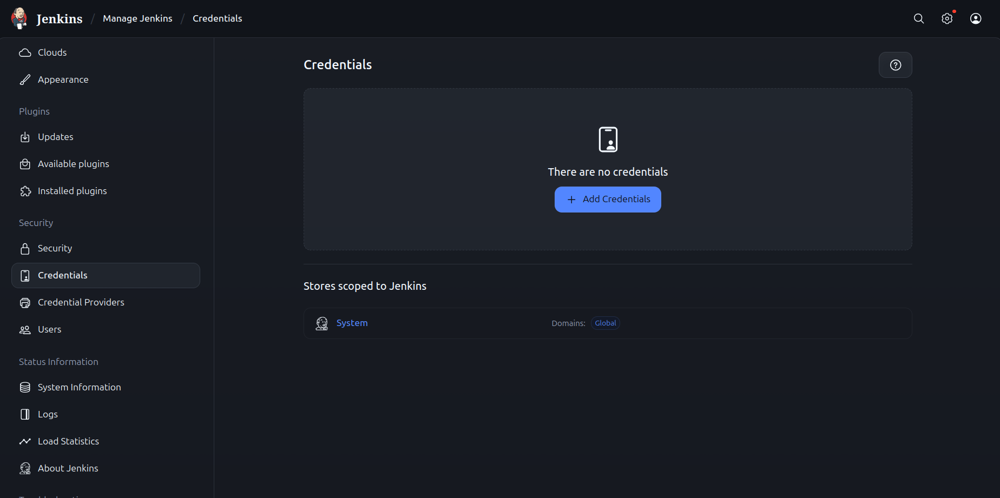
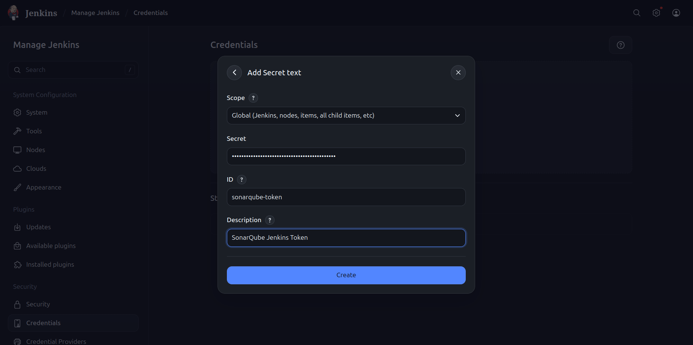
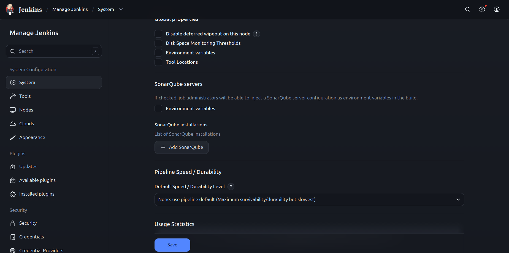
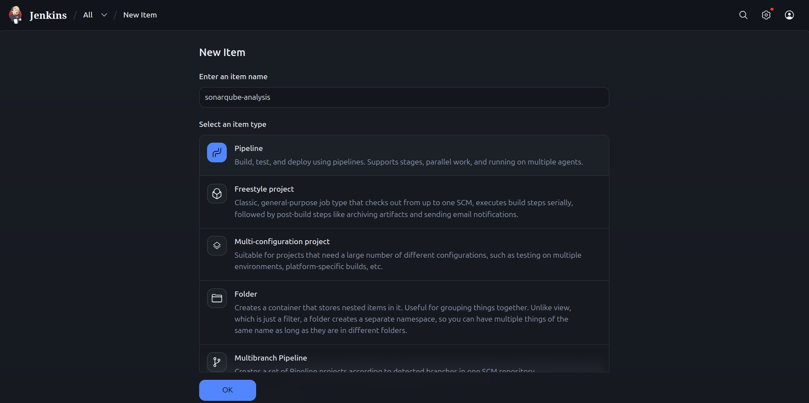
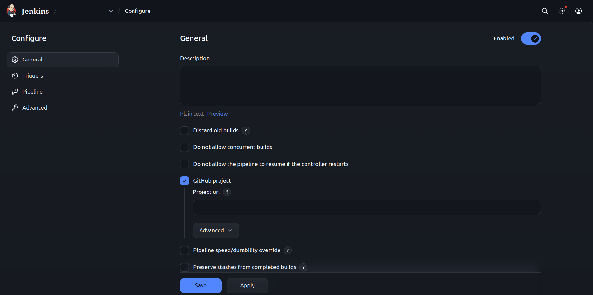
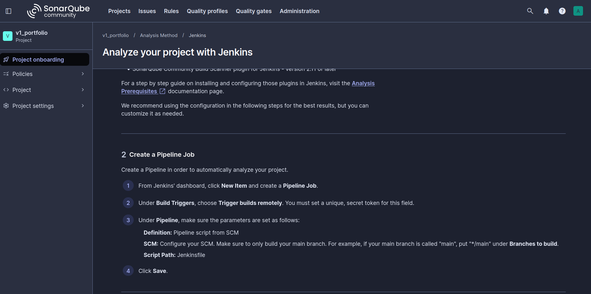
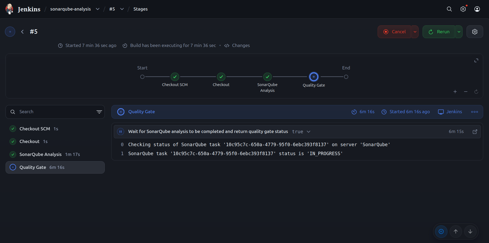
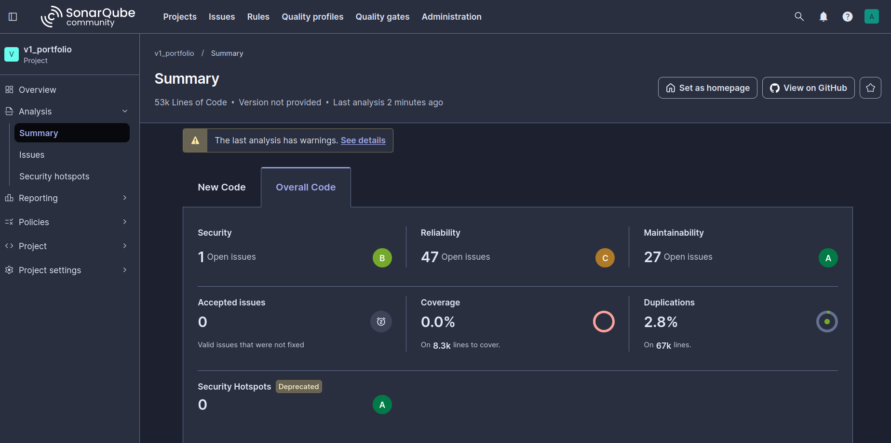

# Jenkins : intégration avec SonarQube

Ce guide configure Jenkins pour lancer une analyse SonarQube sur un dépôt GitHub
et attendre le résultat du Quality Gate. Il suppose que la stack est démarrée
(voir le [README du projet](../../README.md)) et que SonarQube est déjà configuré
(voir [SonarQube](../sonarqube/readme.md)).

Dans ce guide, `jenkins.example.com` et `sonar.example.com` désignent tes propres
domaines.

## Sommaire

1. [Installer le plugin SonarQube Scanner](#1-installer-le-plugin-sonarqube-scanner)
2. [Créer un token dans SonarQube](#2-créer-un-token-dans-sonarqube)
3. [Ajouter le token dans Jenkins](#3-ajouter-le-token-dans-jenkins)
4. [Déclarer le serveur SonarQube](#4-déclarer-le-serveur-sonarqube)
5. [Installer SonarScanner](#5-installer-sonarscanner)
6. [Configurer le webhook SonarQube](#6-configurer-le-webhook-sonarqube)
7. [Donner à Jenkins l'accès au dépôt GitHub](#7-donner-à-jenkins-laccès-au-dépôt-github)
8. [Créer le job Pipeline](#8-créer-le-job-pipeline)
9. [Ajouter le Jenkinsfile](#9-ajouter-le-jenkinsfile)
10. [Lancer et vérifier](#10-lancer-et-vérifier)

## 1. Installer le plugin SonarQube Scanner

1. Ouvre **Manage Jenkins → Plugins → Available plugins**.
2. Recherche **SonarQube Scanner** et installe-le.
3. Redémarre Jenkins si l'interface le demande.



## 2. Créer un token dans SonarQube

1. Dans SonarQube, clique sur ton avatar puis **My Account → Security**.
2. Dans **Generate Tokens**, saisis un nom (par exemple `jenkins`), choisis le
   type **Global Analysis Token** et une durée d'expiration.
3. Clique sur **Generate** et copie le token : il ne sera plus affiché.



> Le token est un secret. Ne le colle jamais dans un fichier du dépôt, un
> Jenkinsfile ou une capture d'écran.

## 3. Ajouter le token dans Jenkins

1. Ouvre **Manage Jenkins → Credentials → System → Global credentials**.
2. Clique sur **Add Credentials** et choisis le type **Secret text**.



| Champ | Valeur |
| --- | --- |
| Scope | Global |
| Secret | le token SonarQube |
| ID | `sonarqube-token` |
| Description | SonarQube Jenkins Token |



## 4. Déclarer le serveur SonarQube

1. Ouvre **Manage Jenkins → System**, section **SonarQube servers**.
2. Clique sur **Add SonarQube** et renseigne :

| Champ | Valeur |
| --- | --- |
| Name | `SonarQube` (ce nom est utilisé dans le Jenkinsfile) |
| Server URL | `http://sonarqube:9000` |
| Server authentication token | `sonarqube-token` |

3. Clique sur **Save**.



Jenkins et SonarQube sont sur le même réseau Docker : l'URL interne
`http://sonarqube:9000` évite de passer par Cloudflare et Cloudflare Access.

## 5. Installer SonarScanner

1. Ouvre **Manage Jenkins → Tools**, section **SonarQube Scanner installations**.
2. Clique sur **Add SonarQube Scanner** :

| Champ | Valeur |
| --- | --- |
| Name | `SonarScanner` (ce nom est utilisé dans le Jenkinsfile) |
| Install automatically | coché, dernière version proposée |

3. Clique sur **Save**.

## 6. Configurer le webhook SonarQube

Le webhook permet à SonarQube de renvoyer le résultat du Quality Gate à Jenkins.
Sans lui, l'étape `waitForQualityGate` reste bloquée sur `IN_PROGRESS`.

Dans SonarQube : **Administration → Configuration → Webhooks → Create**.

| Champ | Valeur |
| --- | --- |
| Name | `jenkins` |
| URL | `http://jenkins:8080/sonarqube-webhook/` |
| Secret | facultatif (à reporter dans Jenkins si utilisé) |

Le `/` final de l'URL est obligatoire.

## 7. Donner à Jenkins l'accès au dépôt GitHub

Pour un dépôt privé, Jenkins a besoin d'un token GitHub en lecture seule.

1. Sur GitHub : **Settings → Developer settings → Personal access tokens →
   Fine-grained tokens → Generate new token**.
2. Configure le token :

| Champ | Valeur |
| --- | --- |
| Token name | `jenkins-read-repository` |
| Repository access | Only select repositories → ton dépôt |
| Contents | Read-only |
| Metadata | Read-only |

3. Génère le token et copie-le.
4. Dans Jenkins, ajoute un credential :

| Champ | Valeur |
| --- | --- |
| Kind | Username with password |
| Username | ton identifiant GitHub |
| Password | le token GitHub (pas ton mot de passe) |
| ID | `github-credentials` |

## 8. Créer le job Pipeline

1. Sur l'accueil de Jenkins, clique sur **New Item**.
2. Nomme le job (par exemple `sonarqube-analysis`), choisis **Pipeline**, puis **OK**.



3. Dans **General**, coche **GitHub project** et indique l'URL du dépôt.



4. Dans **Pipeline**, configure :

| Champ | Valeur |
| --- | --- |
| Definition | Pipeline script from SCM |
| SCM | Git |
| Repository URL | `https://github.com/<utilisateur>/<depot>.git` |
| Credentials | `github-credentials` |
| Branch Specifier | `*/main` |
| Script Path | `Jenkinsfile` |

SonarQube affiche aussi ces étapes dans l'onboarding du projet
(**Analysis Method → Jenkins**) :



## 9. Ajouter le Jenkinsfile

À la racine du dépôt analysé, crée un fichier `Jenkinsfile`. Remplace
`<cle-du-projet>` par la clé affichée dans SonarQube
(**Project settings → General Settings**).

```groovy
pipeline {
    agent any

    stages {
        stage('Checkout') {
            steps {
                checkout scm
            }
        }

        stage('SonarQube Analysis') {
            steps {
                script {
                    def scannerHome = tool 'SonarScanner'
                    withSonarQubeEnv('SonarQube') {
                        sh "${scannerHome}/bin/sonar-scanner -Dsonar.projectKey=<cle-du-projet> -Dsonar.sources=."
                    }
                }
            }
        }

        stage('Quality Gate') {
            steps {
                timeout(time: 10, unit: 'MINUTES') {
                    waitForQualityGate abortPipeline: true
                }
            }
        }
    }
}
```

- `tool 'SonarScanner'` reprend le nom défini à l'étape 5.
- `withSonarQubeEnv('SonarQube')` injecte l'URL et le token définis à l'étape 4.
- `waitForQualityGate` attend le webhook de l'étape 6 et fait échouer le build si
  le Quality Gate est en échec.

## 10. Lancer et vérifier

1. Ouvre le job et clique sur **Build Now**.
2. Dans la vue des étapes, chaque stage doit passer au vert :



3. Le résultat est visible dans SonarQube, dans la page du projet :



### Problèmes fréquents

| Symptôme | Cause probable |
| --- | --- |
| `Quality Gate` reste sur `IN_PROGRESS` | Webhook absent ou mauvaise URL (étape 6) |
| `sonar-scanner: not found` | Outil `SonarScanner` non déclaré (étape 5) |
| `Not authorized` pendant l'analyse | Token expiré ou mauvais credential (étapes 2 à 4) |
| `Authentication failed` au checkout | Token GitHub invalide ou sans accès au dépôt (étape 7) |
