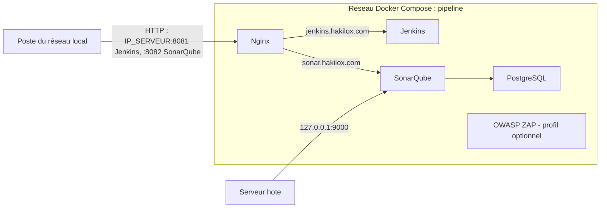

# Architecture

## Périmètre actuellement déployé

La configuration `docker-compose.yml` déploie les services suivants :

| Service | Rôle | Exposition |
| --- | --- | --- |
| Nginx (`nginx-pipeline`) | Reverse proxy HTTP | Ports hôte 8081 (Jenkins) et 8082 (SonarQube) |
| Jenkins | Exécution CI/CD | Réseau Docker uniquement; routé par Nginx |
| SonarQube | Analyse de code | Réseau Docker et `127.0.0.1:9000` sur l'hôte |
| PostgreSQL (`sonarqube-db`) | Base SonarQube | Réseau Docker uniquement |
| OWASP ZAP (`zap`) | Outil de sécurité optionnel | Profil `security-tools`; aucun port publié |

Tous les services utilisent le réseau bridge `pipeline`. Jenkins, SonarQube et
PostgreSQL disposent de volumes nommés pour conserver leurs données.

## Flux réseau

Nginx choisit le service amont selon le nom d'hôte HTTP. Les noms actuels sont
`jenkins.hakilox.com` et `sonar.hakilox.com`; ils sont définis dans
[`nginx/conf.d/default.conf`](../nginx/conf.d/default.conf). Le DNS doit pointer
vers le serveur, ou ces noms doivent être adaptés à l'environnement.

Jenkins n'a pas de port publié sur l'hôte. Nginx le joint par son nom de service
Compose (`jenkins`). Nginx publie Jenkins sur 8081 et SonarQube sur 8082;
limiter ces ports au réseau local avec le pare-feu. SonarQube est aussi lié à
`127.0.0.1:9000`; PostgreSQL n'est pas publié. Cette configuration HTTP locale
n'utilise pas TLS.

ZAP est sous profil optionnel. Sa commande actuelle met à jour les modules
complémentaires puis se termine; elle ne lance pas de scan.

## Architecture cible

Les diagrammes Mermaid ci-dessous décrivent une architecture DevSecOps plus
complète que la stack déployée. Ils incluent des outils non présents dans le
Compose actuel, par exemple Harbor, Vault, DefectDojo, Trivy, Checkov,
Prometheus, Grafana et Falco. Ils servent de cible et ne doivent pas être
interprétés comme des services déjà installés.

- [Vue d'ensemble des composants et de leurs relations](assets/deepseek_mermaid_20261030_4db7ca.mermaid)
- [Séquence envisagée pour un pipeline CI/CD](assets/deepseek_mermaid_20261030_009da0.mermaid)
- [Roadmap de déploiement par phases](assets/deepseek_mermaid_20261030_bac46e.mermaid)

## Captures Jenkins

Captures disponibles dans `assets/`, classées par heure de capture :

